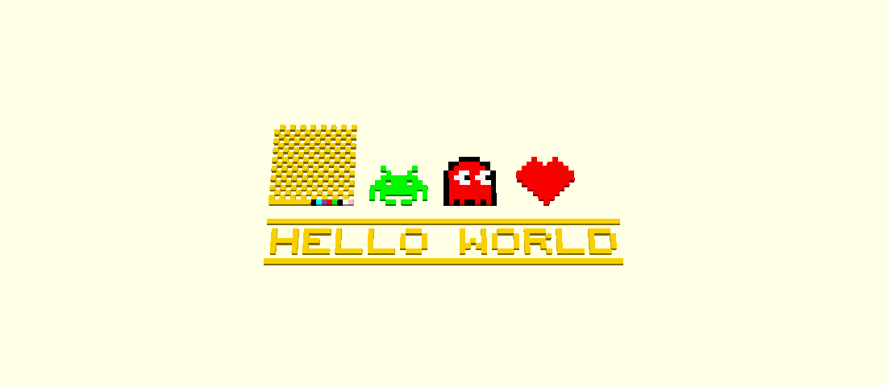
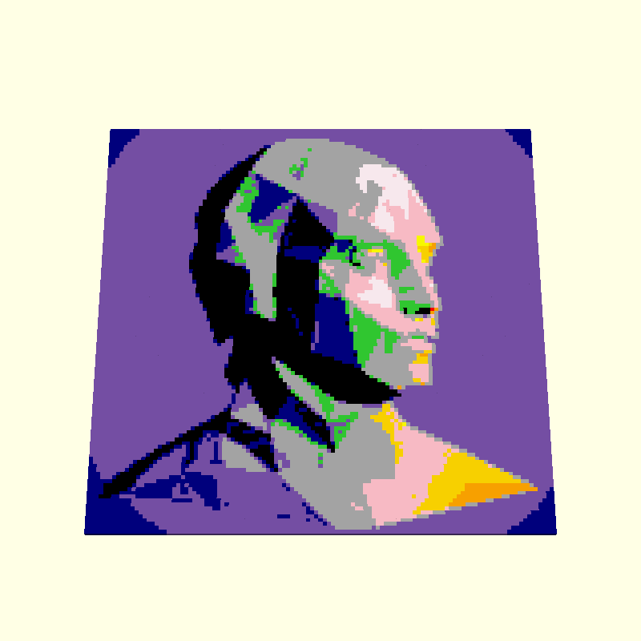

# pixelArtSCAD

An OpenSCAD library for 3D pixel art. A picture is a list of strings, one
character per pixel, and a colormap says which colour each character is. A
Python script turns a PNG into such a list.



## Using the library

```openscad
use <pixel_art.scad>

PixAlien = [
    "  G     G  ",
    "   G   G   ",
    "  GGGGGGG  ",
    " GG GGG GG ",
    "GGGGGGGGGGG",
    "G GGGGGGG G",
    "G G     G G",
    "   GG GG   "
];

PixArt(H=PixAlien);
```

`PixArt(H, pixel = 10, height = 10)` draws one cuboid per character:

- `H` is the list of strings, top row first. A space leaves the pixel empty.
- `pixel` is the side of one pixel and `height` its height, in millimetres.

The art lies in the XY plane and reads upright from above, with the first
character of the last row at the origin.

## Colormap

`colormap.scad` maps characters to RGB values from 0 to 255. A character that
is not in the map is drawn gold.

```openscad
colorMap255 = [
    ["0", [0, 0, 0]],         // Black
    ["1", [255, 215, 0]],     // Gold
    ["%", [255, 240, 245]],   // LavenderBlush
    ["B", [0, 0, 0]],         // Black
    ["W", [255, 255, 255]],   // White
    ["R", [255, 0, 0]],       // Red
    ["G", [0, 255, 0]],       // Green
    ["P", [255, 192, 203]],   // Pink
    ["V", [120, 81, 169]],    // Royal Purple
    ["Y", [255, 255, 0]],     // Yellow
    ["O", [255, 165, 0]],     // Orange
    ["C", [0, 255, 255]],     // Cyan
    ["M", [255, 0, 255]],     // Magenta
    ["N", [0, 0, 128]],       // Navy
    ["L", [50, 205, 50]],     // Lime
    ["D", [169, 169, 169]]    // DarkGray
];
```

## Converting a PNG

`png2pix.py` reads a PNG and writes the array. It needs Python 3.10 or newer
and [Pillow](https://pypi.org/project/pillow/).

```sh
python png2pix.py examples/art/ckbGitHubProfile.png --downscale 4 -o examples/art/pix_ckbGH.scad
```

| Option              | Meaning                                                        |
| ------------------- | -------------------------------------------------------------- |
| `-o`, `--output`    | File to write. Without it the array goes to standard output.   |
| `-n`, `--name`      | Array name. Defaults to `pix_` plus the image's file name.     |
| `-d`, `--downscale` | Shrink the image by this factor first. Defaults to 1.          |
| `-c`, `--colormap`  | Colormap file. Defaults to the `colormap.scad` beside the script. |

Each pixel becomes the character whose colour is nearest in RGB; where two
characters share a colour, the one listed first wins. Fully transparent pixels
become spaces. One pixel of the image, after downscaling, is one cuboid, so a
large image makes a slow model: the 115 x 115 example below takes about nine
seconds to render.

## Examples

### `sample_pixel_art_gallery.scad`

Hand-written patterns, shown at the top of this page.

### `sample_pixel_art_fastlogo.scad`


A converted PNG. The original is a black logo on a transparent background; a
search-and-replace on the generated array made it purple on white.

### `sample_pixel_art_ckbGH.scad`



A converted photo, limited to the colours of the default colormap.

## Development

With [uv](https://docs.astral.sh/uv/), [just](https://just.systems/) and
OpenSCAD installed:

```sh
just setup   # install Pillow, pytest and ruff into .venv
just check   # formatting and lint
just test    # converter tests, then render every example with warnings as errors
```

## License

MIT. See [LICENSE](LICENSE).

## Acknowledgments

Inspired by
[Pixel Art - OpenSCAD by VincentD](https://www.thingiverse.com/thing:1217811)
(CC0 1.0 Universal).
